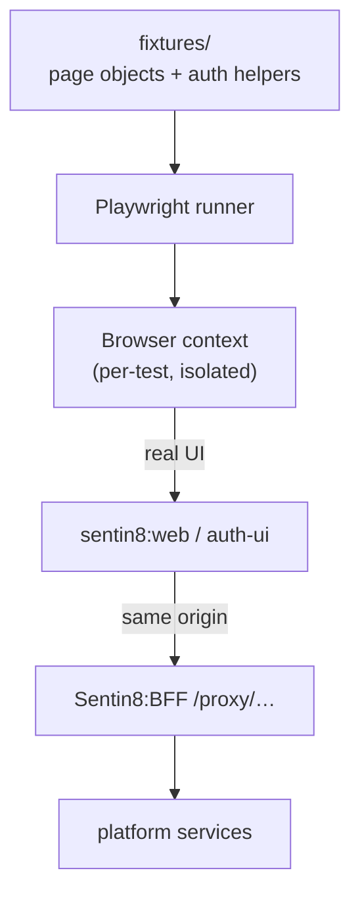

# sentin8-e2e - Detailed Design Document

> Wire-level construction of the platform's E2E suite. Overview in
> `README.md`; the business framing in `BUSINESS.md`.

## 1. Scope & Context

The E2E suite is the platform's **user-truth plane**: it asserts what a
real browser + the real BFF proxy achieve. Its defining constraint
(AGENTS.md E2E rule) is also its architecture:

- **No direct database access** - no `psql`, no SQL, no direct writes.
- **No direct backend HTTP** (except the BFF proxy) - test state is
  built through real UI flows or `/proxy/sys/v1/...`,
  `/proxy/auth/v1/...`.
- **No bypassed authorization** - permissions are acquired through real
  flows (org creation grants org-admin); fixtures never insert roles.

## 2. Runtime Architecture

| Element | Role |
|---|---|
| `playwright.config.ts` | Browser/project matrix, base URL, retries, trace/video policies. |
| `fixtures/` | Page objects (locators, flows) + authenticated context helpers (device-flow-equivalent sign-in through the UI). |
| `tests/` | The suites: auth (sign-up/sign-in/MFA), org/env lifecycle, apps, admin surfaces. |
| `scripts/` | Run helpers; report plumbing. |

## 3. Test Data Lifecycle

1. **Clean state**: tests assume a booted platform (captain fleet + PG +
   Valkey); no fixture mutates the DB. The CLI's M2M workload rows
   (`cli-producer` etc.) are NOT fixture state - the platform's
   provision-on-boot pass converges them from the CLI's own
   `--print-registration` declaration (CLI DESIGN §4.2); after a
   `dev-destroy` reset a plain `make start` restores them.
2. **State construction**: every prerequisite is a real flow - sign-up,
   create org, create env, enable feature, assign role through UI.
3. **Teardown**: browser contexts are per-test; durable test artifacts
   (orgs/users) follow the suite's naming convention for operator
   cleanup.

## 4. Invariants

1. **UI + BFF proxy only** - a setup step impossible through UI/API is a
   product gap, filed as a backend story, never worked around with SQL.
2. **Authorization is earned like a user's** - no role/grant injection.
3. **No secrets in fixtures** - credentials from the environment.
4. **The suite runs against release-mode fleets** (debug fleets are the
   dev pipeline's domain).
5. **Configuration mirrors the fleet's** - the suite reads the SAME
   tree-root `.env` the fleet is booted from (`SENTIN8_DOMAIN`, resolved
   via `SENTIN8_REPO_ROOT`, `process.env` precedence). A hard-coded
   domain default is a defect: URLs are DERIVED, never assumed, and a
   missing `SENTIN8_DOMAIN` (nothing to derive from, nothing to guess)
   fails the run at configuration load - never mid-test.
6. **The CLI binary path derives from the tree, not the operator's
   machine** - `fixtures/testdata.ts` resolves `CLI_BIN` as
   `SENTIN8_CLI_BIN` (explicit override) → else the first existing of
   `{repo_root}/sentin8/sentin8-cli/target/{SENTIN8_CLI_PROFILE:-debug|release|debug}/sentin8-cli`
   (repo root from `SENTIN8_REPO_ROOT`, the same resolution as
   invariant 5). A hard-coded operator-absolute path is the same defect
   class as a hard-coded domain: it dies with `spawn ENOENT` on any other
   checkout or profile.
7. **CLI subprocesses inherit the fleet's TLS posture** - the CLI is a
   rustls client whose key-exchange offer must match the fleet's
   `SENTIN8_TLS_PQ_MODE` (the same tree-root `.env` the fleet is booted
   from, invariant 5). `runCli` injects the fleet TLS posture vars into
   every CLI child; without them a classical-postured fleet rejects the
   CLI's default PQ offer with a TLS `HandshakeFailure` - the CLI's
   `signup`/`call` fail as connection errors with no HTTP trace, and
   the fixture's "idempotent signup" silently leaves the persona
   nonexistent (the device flow then 401s its approval sign-in and
   times out). The suite's own `process.env` is NOT the channel: the
   operator's Playwright process is not a fleet boot and carries none
   of the fleet env.
8. **Semantics presence is not content presence** - `waitForFlutterSemantics`
   only waits for the FIRST `flt-semantics` node to exist (the shell:
   sidebar, breadcrumbs, header). RFW page content (the service's admin
   cards/tables) lands asynchronously AFTER that, once
   `GET /v1/admin/ui/{page}` resolves and the canvas paints. Any test
   that asserts page content must therefore call `waitForFlutterContent`
   between `waitForFlutterSemantics` and `getFlutterTexts` - harvesting
   texts immediately after semantics-presence is a race that can return
   `0` on a slow paint and fail a healthy page. Asserting a page that
   may legitimately be empty (no rows yet) skips the texts assertion but
   keeps `waitForFlutterContent` for the page shell, relying on
   `strict.assertNoFailures()` for API errors.

## 5. Testing Strategy (of this repo)

- This repo IS the top of the platform test pyramid; its own "tests are
  the product". `pnpm run test:ui` is the single entry; the report is
  Playwright's.
- Suite granularity follows journeys (sign-up → first org → first app),
  not endpoint lists.

## 6. Open Questions

- Fleet-plane journeys (a provisioned machine's smoke via UI surfaces)
  carry the docker-macvlan scenario.

---

**Architecture & Design:** sentin8:e2e and its underlying concepts were designed by [Hamid Jahanzad](https://www.linkedin.com/in/hamidjahanzad/).
